I'm Jomer, a full-stack developer. I build websites, web apps and mobile apps, and I start every project with one question: who is this actually for?

**Open to work** in full-stack roles and **open for freelance** websites for small businesses. [Email me](mailto:jomerignacio04@gmail.com).

## Selected work

| Project | What it is | Built with | Status |
| --- | --- | --- | --- |
| [**Project One**](https://github.com/Hadesxzc) | One or two sentences on what it does and who it is for. | Next.js, Supabase | In development |
| **Project Two** | One or two sentences on what it does and who it is for. | Expo, FastAPI | MVP |
| **Project Three** | One or two sentences on what it does and who it is for. | React, Node | Early beta |
